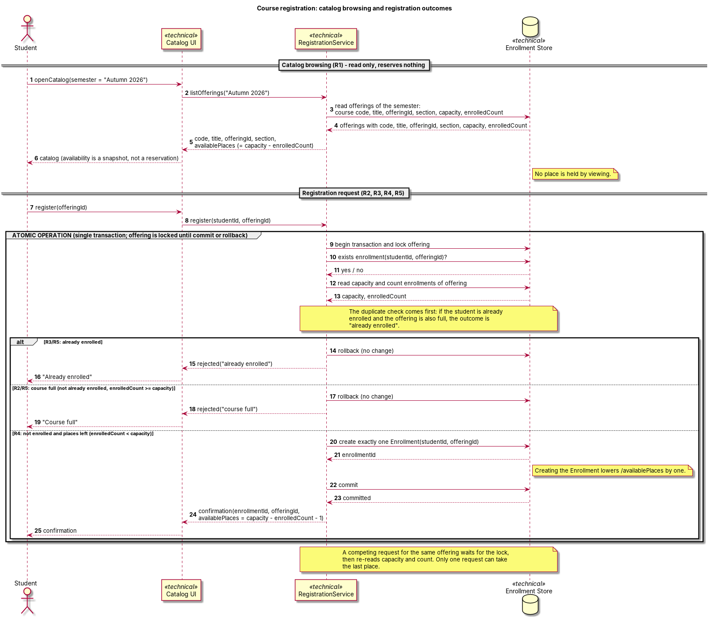
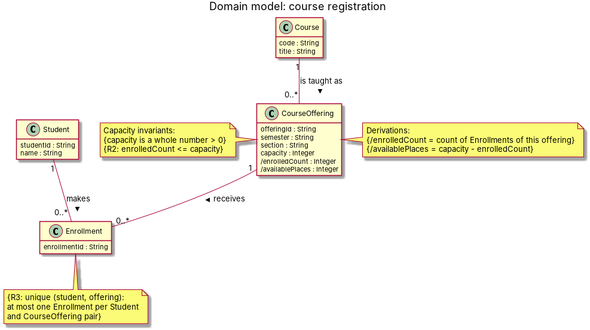
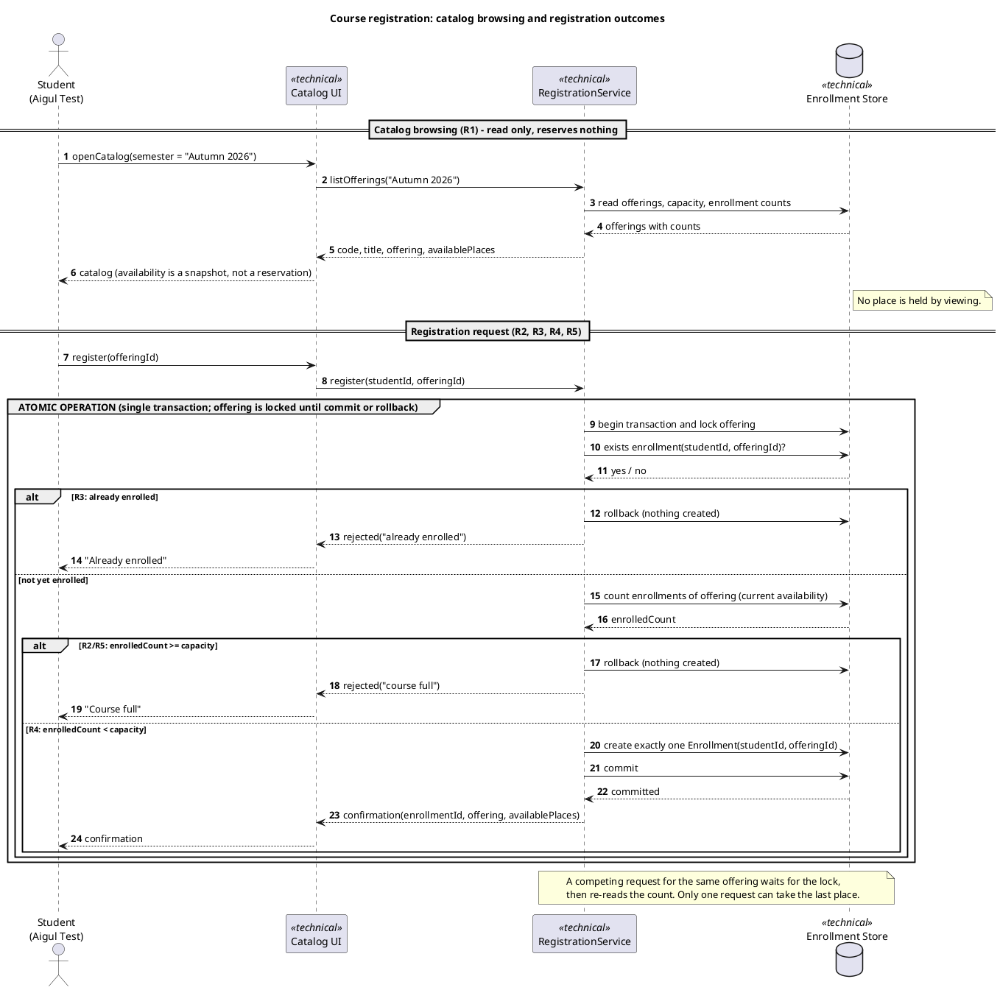
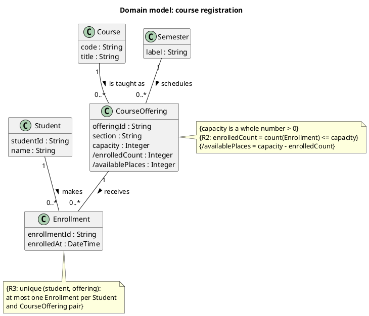
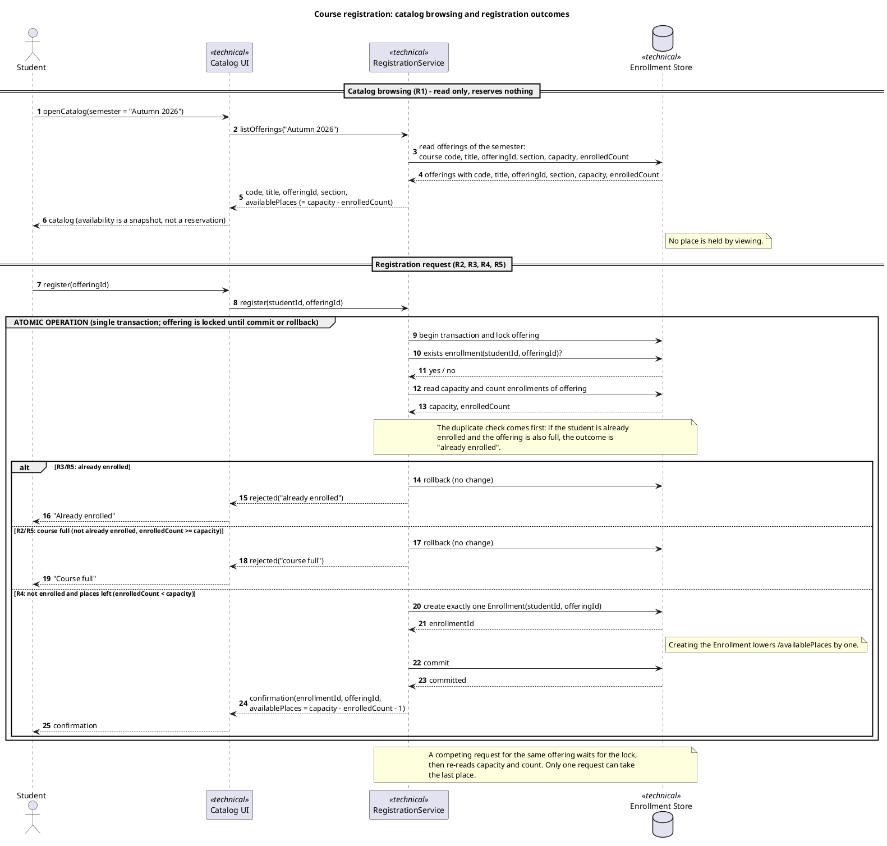
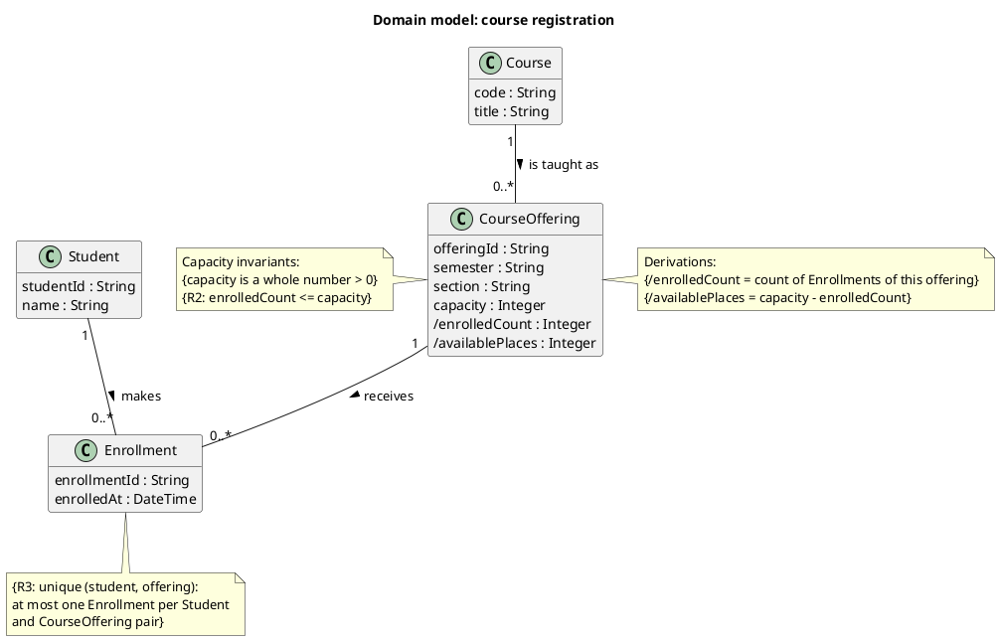
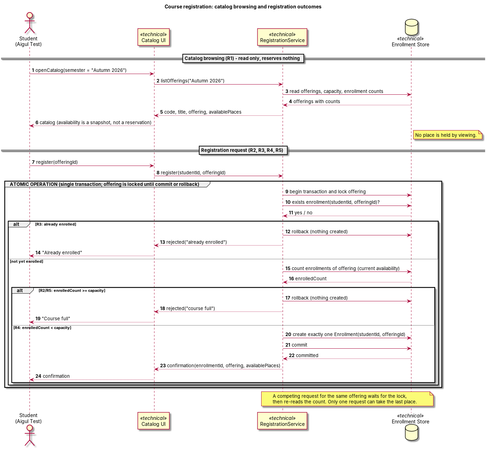
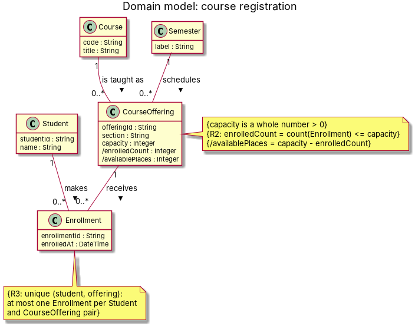

# SIS #02 — AI-Assisted UML Modeling: University Course Registration

<!--
  This is the only file you write your report in. README.md tells you what goes where.

  Rules the checker relies on:
  - Do not delete, rename or renumber the ## headings, the ### headings, or the **Label:** words.
  - Replace every "(write here)" and "(paste here)". None may be left when you submit.
  - Comments like this one are ignored by the checker and the word counter. Delete them or leave them.
-->

## 1. Scope and assumptions

<!-- Your FINAL scope statement and assumptions, after reviewing Prompt A's output. Say here
     what is out of scope (payments, prerequisites, timetable clashes, waiting lists,
     cancellation) — section 2 must not mention them. Section 10 keeps your first version. -->

**Scope:** I model one use case of the course registration system: a signed-in student browses the catalog of course offerings for one semester, picks one offering and requests registration, which either creates exactly one Enrollment or is rejected as "course full" or "already enrolled". Payments, prerequisites, timetable clashes, waiting lists and cancellation are out of scope and appear nowhere in the requirements or diagrams.

**Assumptions:**

1. A catalog view only shows the number of free places and reserves nothing; capacity and the duplicate condition are checked again, under a lock, when the student registers (R2).
2. "Already enrolled" means the same student already has an Enrollment in the same CourseOffering; an Enrollment in another offering of the same course does not block the request (R3, AC-04).
3. If the student is already enrolled and the offering is also full, the duplicate check runs first, so the answer is "already enrolled" (the rules do not fix this order; it is my modeling decision).
4. Availability is derived: availablePlaces = capacity minus the number of Enrollments, so creating an Enrollment is what updates availability (R4).

## 2. User stories and acceptance criteria

<!-- Your APPROVED requirements: Prompt A's draft after your review. Keep the IDs, the three
     story headings and the bullet shape. Every criterion names the rule(s) it maps to,
     e.g. (R2, R4). Two criteria per story. Nothing out of scope.
     Format of a criterion, on one bullet:
     - **AC-03** (R2, R4): Given ..., When ..., Then ... -->

### US-01 — Browse offerings

**US-01:** As a student, I want to see the offerings for one semester with their available places, so that I can choose an offering to register for.

- **AC-01** (R1): Given the semester "Autumn 2026" has the offering "Intro to Astronomy, ASTR101, Section A" with capacity 30 and 12 enrollments, When the student opens the catalog for Autumn 2026, Then the catalog lists that offering with course code "ASTR101", title "Intro to Astronomy", the offering identifier, and "18 places available".
- **AC-02** (R1): Given the offering "Pottery Basics, ART110, Section B" has capacity 20 and 20 enrollments, When the student views the catalog and then leaves without registering, Then the catalog shows 0 available places for that offering, and viewing it creates no enrollment and changes no availability for any offering.

### US-02 — Register for an offering

**US-02:** As a student, I want to register for a specific offering, so that I get a confirmed place if one is still free.

- **AC-03** (R2, R4): Given the student "Aigul Test" has no enrollment in "ASTR101 Section A", and that offering has capacity 30 and 29 enrollments at the moment of the request, When Aigul requests registration for that offering, Then exactly one Enrollment linking Aigul and that offering is created, the enrollment count becomes 30, the available places become 0, and a confirmation is returned.
- **AC-04** (R3, R4): Given Aigul is enrolled in "ASTR101 Section A", and "ASTR101 Section B" has at least one free place, When Aigul requests registration for "ASTR101 Section B", Then the duplicate check does not reject the request, because it concerns a different offering, and registration proceeds under R4 with exactly one new Enrollment.

### US-03 — Receive a clear rejection

**US-03:** As a student, I want a rejected registration to tell me why (course full or already enrolled), so that I know what happened and no place is taken by mistake.

- **AC-05** (R2, R5): Given "ASTR101 Section A" has capacity 30 and 29 enrollments, and both Aigul and "Bekzat Test" have seen "1 place available" in the catalog, When both request registration at the same time, Then the final availability check and enrollment creation run as one atomic operation per request, so exactly one request succeeds, the other is rejected with "course full", and the enrollment count is 30 and never above 30.
- **AC-06** (R3, R5): Given Aigul already has an enrollment in "ASTR101 Section A", which still has free places, When Aigul requests registration for "ASTR101 Section A" again, Then the request is rejected with "already enrolled", no new Enrollment is created, and the enrollment count is unchanged.

Review of Prompt A's draft (what I changed): AC-02 was mapped to R1 and R2; it only shows a catalog and changes nothing, so I map it to R1 only. The AI put the contested-last-place rejection (its AC-04) under US-02 and the different-offering case (its AC-06) under US-03, so US-03 mixed a success with a rejection; I renumbered them so that US-02 holds the two success criteria (AC-03, AC-04) and US-03 the two rejections (AC-05 course full, AC-06 already enrolled), and reworded US-03 to match its heading. Nothing out of scope was in the draft. Its uncertainties U-01 and U-02 became my assumptions 2 and 3.

## 3. Sequence diagram

<!-- The FINAL diagram, rendered. Change .png to .svg if that is what you exported. -->



**Participants:** Student (actor, the signed-in student; same name as the Student class); Catalog UI (technical: the screen that shows the catalog and sends the request); RegistrationService (technical: runs the checks and the creation); Enrollment Store (technical, database: holds offerings and Enrollments and gives the lock).

**Atomic operation:** the group "ATOMIC OPERATION" holds, in one transaction under a lock on the offering: the duplicate check (exists enrollment), the capacity check (read capacity and count enrollments), and, on the success branch only, the creation of the Enrollment and the commit. Both rejection branches end with "rollback (no change)". A catalog view reserves nothing because the catalog messages only read and are outside the group; the numbers it shows are a snapshot, so they are read again inside the lock.

**Where the Enrollment is created:** the message "create exactly one Enrollment(studentId, offeringId)" from RegistrationService to Enrollment Store, inside the success branch "R4: not enrolled and places left"; it produces one object of the class Enrollment in section 4, linked to one Student and one CourseOffering, and the store returns its enrollmentId before the confirmation.

**Technical lifelines:** Catalog UI, RegistrationService and Enrollment Store are not classes in the class diagram. The class diagram shows what the domain contains (Student, Course, CourseOffering, Enrollment); the sequence diagram shows who does the work at run time, so it needs a screen, a service and a store. They are marked <<technical>> so nobody reads them as domain concepts.

## 4. Class diagram

<!-- The FINAL diagram, rendered. -->



<!-- One row per association in classes.puml, read in both directions. -->

| Association | Read left to right | Read right to left |
| --- | --- | --- |
| Student — Enrollment (makes) | One Student makes zero or many Enrollments | Each Enrollment is made by exactly one Student |
| CourseOffering — Enrollment (receives) | One CourseOffering receives zero or many Enrollments | Each Enrollment is for exactly one CourseOffering |
| Course — CourseOffering (is taught as) | One Course is taught as zero or many CourseOfferings (a course may have no section this semester) | Each CourseOffering is a section of exactly one Course |

**How an Enrollment links a student to an offering:** Enrollment sits between Student and CourseOffering with multiplicity 1 at both of those ends, so every Enrollment has exactly one Student and exactly one CourseOffering; the many side (0..*) lets a student hold several enrollments in different offerings and an offering receive many students.

**Capacity constraint:** two notes on CourseOffering: "Derivations" ({/enrolledCount = count of Enrollments of this offering}, {/availablePlaces = capacity - enrolledCount}) and "Capacity invariants" ({capacity is a whole number > 0}, {R2: enrolledCount <= capacity}). Multiplicity 0..* only says "any number"; the upper bound depends on the value of the capacity attribute of each offering, which a fixed multiplicity cannot express.

**Uniqueness constraint:** the note on Enrollment: {R3: unique (student, offering): at most one Enrollment per Student and CourseOffering pair}. The two 1-ends say each Enrollment has one student and one offering, but they do not forbid two different Enrollment objects with the same pair; that is a rule across instances, so it has to be a constraint in a note.

## 5. Traceability

<!-- Every rule, including the catalog fields and availability (R1). Column 1: the rule and
     the criteria that cover it, e.g. "R2 + AC-03, AC-04". Column 2: the message, guard,
     class or constraint that shows the rule in YOUR diagrams. Column 3: the T-ID that
     exercises it, or the extra check you did instead (R1 has no T case). -->

| Rule and criterion | Model evidence | Validation case |
| --- | --- | --- |
| R1 + AC-01, AC-02 | Messages "listOfferings" and "read offerings of the semester: course code, title, offeringId, section, capacity, enrolledCount", reply "code, title, offeringId, section, availablePlaces"; Course.code, Course.title, CourseOffering.semester | Extra check instead of a T case: AC-01 traced by hand, 30 - 12 = 18 places shown, and nothing in the catalog part writes or locks |
| R2 + AC-03, AC-05 | Inside the ATOMIC group: "read capacity and count enrollments", guard "course full"; note "Capacity invariants": R2 enrolledCount <= capacity | T2, T3 |
| R3 + AC-04, AC-06 | Inside the ATOMIC group: "exists enrollment(studentId, offeringId)?", guard "already enrolled"; note on Enrollment: R3 unique (student, offering) | T4 |
| R4 + AC-03, AC-04 | Success branch "not enrolled and places left": "create exactly one Enrollment", reply enrollmentId, commit, then "confirmation"; note that creation lowers /availablePlaces | T1, T2 |
| R5 + AC-05, AC-06 | Branches "already enrolled" and "course full": "rollback (no change)", then rejected("already enrolled") / rejected("course full"); nothing created | T3, T4 |

## 6. Walkthroughs

<!-- Walk each case through YOUR final sequence diagram, message by message. Column 2: the
     actual steps and the state change (count before → after). Column 3 starts with Pass or
     Fail, then the location: the message, guard or note where you saw it. A Fail you
     report honestly is a finding, not a penalty. -->

| Case | Observed path and state change | Judgment and evidence |
| --- | --- | --- |
| T1. Available | Capacity 2, enrolled 0, new student. register(offeringId) then register(studentId, offeringId); inside the atomic group: begin transaction and lock offering, exists enrollment returns no, read capacity and count returns 2 and 0; guard "not enrolled and places left" holds; create exactly one Enrollment, enrollmentId returned, commit, confirmation. Count 0 to 1. | Pass. Success branch "not enrolled and places left", message "create exactly one Enrollment" followed by "confirmation". |
| T2. Last place | Capacity 2, enrolled 1, new student. Same request messages; under the lock exists enrollment returns no, read capacity and count returns 2 and 1; 1 < 2 so guard "not enrolled and places left" holds; create, commit, confirmation with availablePlaces 0. Count 1 to 2, no places remain. | Pass. Guard "not enrolled and places left" and the note that creation lowers /availablePlaces to 0. |
| T3. Full | The catalog earlier showed 1 place (snapshot). Another request took it, count is now 2 of 2. This student's register waits for the lock, exists enrollment returns no, read capacity and count returns 2 and 2; guard "course full"; rollback (no change); rejected("course full"). Count stays 2, no record. | Pass. Guard "course full" inside the ATOMIC group, and the atomic note: the count is re-read under the lock, not taken from the catalog. |
| T4. Duplicate | Capacity 2, enrolled 1 and it is this student. register again; under the lock exists enrollment returns yes; guard "already enrolled" is checked first; rollback (no change); rejected("already enrolled"). Count stays 1, no new Enrollment. | Pass. Guard "already enrolled" and message rejected("already enrolled"); no create in that branch. |

## 7. Review decisions

<!-- At least three substantive decisions about Prompt C's critique or your own inspection.
     Decision: accepted / rejected / modified — and what you did. Reason: why, in a full
     sentence. Rule: R1–R5. Do not invent an error to fill the table; a justified rejection
     of advice counts. -->

| AI suggestion or model element | Decision | Reason | Rule |
| --- | --- | --- | --- |
| Original sequence: "read offerings, capacity, enrollment counts" happens only in the catalog flow, and the guard "enrolledCount >= capacity" uses that capacity (critique D1) | accepted: added "read capacity and count enrollments of offering" inside the ATOMIC group, reply "capacity, enrolledCount" | The guard used a capacity read outside the lock, so a value from a stale catalog view could decide whether a place exists. | R2 |
| Original sequence: confirmation(enrollmentId, offering, availablePlaces) with no reply to "create exactly one Enrollment" (critique D2) | accepted: the store now returns enrollmentId, the confirmation comes after commit, and a note says creation lowers /availablePlaces | The confirmation must report something that really exists, and R4 also asks that availability is updated, which was invisible. | R4 |
| Original class: Semester class with no requirement and no ' why: comment, and CourseOffering had no semester attribute | modified (my own decision): removed the Semester class, added semester : String to CourseOffering | R1 only needs the semester as a filter for the catalog, so a separate class is an unjustified extra element. | R1 |
| Original sequence: nested alt with guards "R2/R5: enrolledCount >= capacity" and "R4: enrolledCount < capacity" | modified (my own decision): one flat alt with guards already enrolled, course full, not enrolled and places left; rejection says "rollback (no change)" | R5 requires the student to be told course full or already enrolled, so the guards should name those outcomes and not only a comparison. | R5 |
| Critique optional 2: replace the group by a critical fragment | rejected: kept group "ATOMIC OPERATION" plus the lock note | The assignment says a note describing the atomic operation is enough, and the group already shows which messages are atomic. | R2 |
| Critique optional 7: allow capacity >= 0 | rejected: kept capacity as a whole number > 0 | The scenario states that capacity is a positive whole number, so a zero capacity would invent a policy. | R2 |
| Critique optional 3: second Student actor or par block for the race in AC-05 | rejected: kept one Student and the lock note | A par block would suggest parallel work inside the atomic step; the note already explains that a competing request waits and re-reads. | R2 |
| Revision D output: Enrollment.enrolledAt kept although D itself flagged it as unrequired | modified (my own edit after Prompt D): removed enrolledAt from Enrollment | No rule or criterion uses the enrollment time, so the attribute is decoration that the class diagram does not need. | R4 |

## 8. Modeling explanation

<!-- 200–300 words. Your main design choices; how the class diagram and the sequence diagram
     complement each other; why an activity diagram could also help explain the workflow. -->

The class diagram answers what exists. It has the four required classes and nothing more: Course carries the code and title that R1 shows, CourseOffering carries the semester, section and capacity, and Enrollment is the link object between one Student and one CourseOffering. I made enrolledCount and availablePlaces derived attributes, so the number of places can never disagree with the number of Enrollment objects. Two rules cannot be drawn with multiplicities: the capacity bound depends on each offering's capacity value, and uniqueness is a rule across pairs of objects, so both are notes. I removed the AI's Semester class because the scenario needs the semester only as a catalog filter.

The sequence diagram answers how one request runs. The catalog part only reads, so a view reserves nothing. The registration part puts the duplicate check, the capacity check and the creation inside one atomic group under a lock on the offering; a competing request waits and re-reads the count, which is how two students cannot both take the last place. Exactly one Enrollment is created, only in the success branch, and the confirmation comes after the commit. Both rejection branches roll back and only return a reason.

The two diagrams check each other: every message that reads or changes data in the sequence diagram must refer to an attribute or object in the class diagram, and the walkthroughs T1 to T4 use both. An activity diagram would also help, because it shows the decision order from the student's point of view without technical lifelines: browse, request, already enrolled?, full?, create or reject. That order, duplicate before capacity, is a modeling choice that an activity diagram would make easier to discuss with a non-technical reader.

## 9. Reflection

<!-- 150–200 words. Written by you, not by the assistant: where AI helped, one decision you
     made yourself, one remaining limitation. Specific beats flattering. -->

The assistant was useful for the first drafts. Prompt A gave me six criteria with concrete numbers, like capacity 30 and 29 enrollments, which made the walkthroughs easy to check. Prompt B produced a sequence diagram that already had a lock and a rollback, which I would not have drawn so quickly myself. The critique in the new chat found something I had missed: the capacity used by the guard was only read in the catalog flow, outside the lock, so the main R2 check was based on old data.

One decision I made myself was to remove the Semester class and keep semester as an attribute. The critique did not ask for this, but R1 only needs a semester filter. I also rejected the critique's idea to allow capacity zero, because the scenario says the capacity is positive.

A limitation remains: the order of the two checks, duplicate before capacity, is my assumption. No rule or criterion covers a student who is already enrolled in a full offering, so the teacher might expect a different answer there.

## 10. Appendix A — Before AI

<!-- Written BEFORE you run Prompt A, committed and pushed in your first commit, and never
     edited afterwards. This is what you paste into Prompt A as "My initial assumptions". -->

**Scope:** I model one use case of the course registration system: a signed-in student browses the catalog of course offerings for one semester, picks one offering and requests registration, which either creates one enrollment or is rejected as course full or already enrolled. Payments, prerequisites, timetable clashes, waiting lists and cancellation are out of scope.

**Initial assumptions:**

1. A catalog view only shows the number of free places and reserves nothing, so the free places can be gone by the time the student presses register; the capacity is checked again at registration.
2. "Already enrolled" means the same student already has an enrollment in the same offering; being enrolled in a different offering of the same course does not block the request.

## 11. Appendix B — AI exchanges

<!-- Complete prompts and complete responses, as text — never screenshots. Paste each inside
     the ~~~~ block that follows its label: AI responses contain ``` PlantUML blocks, and
     ~~~~ keeps them from breaking this file. Prompts B and C: the prompt text first, then
     the material it refers to ("below", "these two") pasted under it, in the same block.
     You may add B5, B6 … after B4 if you ran more. -->

**Note on the transcripts:** the assistant's replies reached me HTML-escaped (`&lt;` and `&gt;` instead of angle brackets); I restored the angle brackets and changed nothing else. Prompt B carried the scenario, R1-R5 and the approved section 2 below the fixed prompt text.

### B1 — Requirements (Prompt A)

- **Tool:** Claude, run as a fresh sub-agent chat inside Claude Code (chat 1)
- **Model:** Claude Sonnet 5.5 (claude-sonnet-5-5)
- **Date:** 2026-10-18
- **Purpose:** draft 3 user stories and 6 acceptance criteria

<!-- Model: the exact model with its version, as the tool shows it (e.g. "GPT-5 Thinking",
     "Claude Sonnet 4.5"). If the tool does not show it, write: not displayed
     Date: YYYY-MM-DD -->

**Prompt:**

~~~~text
Act as a requirements analyst. Use only this course registration scenario and rules R1–R5: A student browses an electronic course catalog, chooses a course offering and requests registration. Each offering has a limited number of places. A Course describes a subject. A CourseOffering is one scheduled section in one semester. Registration always targets a specific offering. Assume that the student is signed in, the selected offering exists, and its capacity is a positive whole number. Exclude payments, prerequisites, timetable clashes, waiting lists and cancellation. Use fictional students and courses. R1. Catalog: Show the course code, title, offering and available places for one semester. R2. Capacity: Recheck current availability when registering. Enrollment must never exceed the offering's capacity. R3. Duplicates: A student may have at most one enrollment in the same offering. Reject a repeat request. R4. Success: Create exactly one Enrollment linking the student and offering, update availability and return a confirmation. R5. Rejection: Explain "course full" or "already enrolled". Create no enrollment and leave the enrollment count unchanged. A catalog view does not reserve a place. Model the final checks and enrollment creation as one atomic operation, so competing requests cannot take the same last place. My initial assumptions are 1. A catalog view only shows the number of free places and reserves nothing, so the free places can be gone by the time the student presses register; the capacity is checked again at registration. 2. "Already enrolled" means the same student already has an enrollment in the same offering; being enrolled in a different offering of the same course does not block the request.
Draft 3 user stories and 2 Given / When / Then acceptance criteria for each. Use IDs US-01 to US-03 and AC-01 to AC-06. Map each criterion to rule IDs.
Cover normal and rejection behavior. List uncertainty separately. Do not add excluded features or invent university policies.
~~~~

**Response:**

~~~~text
# Course registration: user stories and acceptance criteria

Both of your assumptions fit R1–R5. Assumption 1 matches R1 and R2 and the "no reservation" note. Assumption 2 is consistent with R3, which says "same offering", but the rules never mention other offerings of the same course (see U-01).

## US-01: Browse the catalog
As a student, I want to see the offerings for one semester with their available places, so that I can choose an offering to register for.

**AC-01 (normal): catalog content** [R1]
- Given the semester "Autumn 2026" has the offering "Intro to Astronomy, ASTR101, Section A" with capacity 30 and 12 enrollments
- When the student opens the catalog for Autumn 2026
- Then the catalog lists that offering with course code "ASTR101", title "Intro to Astronomy", the offering identifier, and "18 places available".

**AC-02 (boundary/rejection context): full offering and no reservation** [R1, R2]
- Given the offering "Pottery Basics, ART110, Section B" has capacity 20 and 20 enrollments
- When the student views the catalog and then leaves without registering
- Then the catalog shows 0 available places for that offering, and viewing it creates no enrollment and changes no availability for any offering.

## US-02: Register for an offering
As a student, I want to register for a specific offering, so that I get a confirmed place if one is still free.

**AC-03 (normal): successful registration** [R2, R4]
- Given the student "Aigul Test" has no enrollment in "ASTR101 Section A", and that offering has capacity 30 and 29 enrollments at the moment of the request
- When Aigul requests registration for that offering
- Then exactly one Enrollment linking Aigul and that offering is created, the enrollment count becomes 30, the available places become 0, and a confirmation is returned.

**AC-04 (rejection/concurrency): last place contested** [R2, R5]
- Given "ASTR101 Section A" has capacity 30 and 29 enrollments, and both Aigul and "Bekzat Test" have seen "1 place available" in the catalog
- When both request registration at the same time
- Then the final availability check and enrollment creation run as one atomic operation per request, so exactly one request succeeds, the other is rejected with "course full", and the enrollment count is 30 and never above 30.

## US-03: Prevent duplicate enrollment
As a student, I want a repeat registration for the same offering to be refused with a clear reason, so that I do not hold two enrollments in one offering.

**AC-05 (rejection): repeat request** [R3, R5]
- Given Aigul already has an enrollment in "ASTR101 Section A", which still has free places
- When Aigul requests registration for "ASTR101 Section A" again
- Then the request is rejected with "already enrolled", no new Enrollment is created, and the enrollment count is unchanged.

**AC-06 (normal): different offering of the same course is not blocked** [R3, R4]
- Given Aigul is enrolled in "ASTR101 Section A", and "ASTR101 Section B" has at least one free place
- When Aigul requests registration for "ASTR101 Section B"
- Then the duplicate check does not reject the request, because it concerns a different offering, and registration proceeds under R4 with exactly one new Enrollment.

## Rule coverage
| Rule | Criteria |
|---|---|
| R1 | AC-01, AC-02 |
| R2 | AC-02, AC-03, AC-04 |
| R3 | AC-05, AC-06 |
| R4 | AC-03, AC-06 |
| R5 | AC-04, AC-05 |

## Uncertainties
- **U-01: Same course, different offering.** R3 only restricts the same offering. AC-06 follows your assumption 2 but is not confirmed by the stated rules, so a stakeholder should confirm it.
- **U-02: Both conditions at once.** The rules do not say which reason to give when the offering is full and the student is already enrolled in it. No criterion fixes the order of the checks.
- **U-03: Confirmation content.** R4 requires "a confirmation" but does not say what it contains. The criteria only require that one is returned.
- **U-04: Exact rejection wording.** R5 names "course full" and "already enrolled", but exact message text and format are unspecified.
- **U-05: Catalog scope.** R1 does not say what to show for a semester with no offerings, or whether a full offering should be listed. AC-02 assumes full offerings are listed with 0 places.
- **U-06: Refresh after outcome.** The rules do not say whether the catalog's displayed places update automatically after a success or a rejection.
- **U-07: Simultaneous repeat by one student.** Two concurrent requests from the same student for the same offering (for example a double click) are not described. R3 and the atomicity note imply only one enrollment results, but no criterion tests it.
- **U-08: Requests during concurrent contention beyond one place.** The rules do not say what happens to a student's request that fails the capacity check at the moment of competition other than a "course full" rejection (for example, whether retrying is allowed). I assumed a plain rejection, with no waiting list, as that is excluded.
~~~~

### B2 — UML drafts (Prompt B)

- **Tool:** Claude, run as a fresh sub-agent chat inside Claude Code (chat 1, same chat as B1)
- **Model:** Claude Sonnet 5.5 (claude-sonnet-5-5)
- **Date:** 2026-10-18
- **Purpose:** draft the sequence and class diagrams

**Prompt:**

~~~~text
Using my approved scenario, R1–R5, stories and criteria below, return separate PlantUML code blocks for a sequence diagram and a domain class diagram.
Sequence: include catalog browsing and guarded success, full-course and duplicate outcomes. Model final checks and creation as one atomic operation.
Class: show domain concepts, useful attributes and multiplicities. State the capacity and uniqueness constraints. Explain assumptions and any technical lifelines.

Scenario: A student browses an electronic course catalog, chooses a course offering and requests registration. Each offering has a limited number of places. A Course describes a subject. A CourseOffering is one scheduled section in one semester. Registration always targets a specific offering. Assume that the student is signed in, the selected offering exists, and its capacity is a positive whole number. Exclude payments, prerequisites, timetable clashes, waiting lists and cancellation. Use fictional students and courses.
R1. Catalog: Show the course code, title, offering and available places for one semester.
R2. Capacity: Recheck current availability when registering. Enrollment must never exceed the offering's capacity.
R3. Duplicates: A student may have at most one enrollment in the same offering. Reject a repeat request.
R4. Success: Create exactly one Enrollment linking the student and offering, update availability and return a confirmation.
R5. Rejection: Explain "course full" or "already enrolled". Create no enrollment and leave the enrollment count unchanged.
A catalog view does not reserve a place. Model the final checks and enrollment creation as one atomic operation, so competing requests cannot take the same last place.

US-01: As a student, I want to see the offerings for one semester with their available places, so that I can choose an offering to register for.
- AC-01 (R1): Given the semester "Autumn 2026" has the offering "Intro to Astronomy, ASTR101, Section A" with capacity 30 and 12 enrollments, When the student opens the catalog for Autumn 2026, Then the catalog lists that offering with course code "ASTR101", title "Intro to Astronomy", the offering identifier, and "18 places available".
- AC-02 (R1): Given the offering "Pottery Basics, ART110, Section B" has capacity 20 and 20 enrollments, When the student views the catalog and then leaves without registering, Then the catalog shows 0 available places for that offering, and viewing it creates no enrollment and changes no availability for any offering.

US-02: As a student, I want to register for a specific offering, so that I get a confirmed place if one is still free.
- AC-03 (R2, R4): Given the student "Aigul Test" has no enrollment in "ASTR101 Section A", and that offering has capacity 30 and 29 enrollments at the moment of the request, When Aigul requests registration for that offering, Then exactly one Enrollment linking Aigul and that offering is created, the enrollment count becomes 30, the available places become 0, and a confirmation is returned.
- AC-04 (R3, R4): Given Aigul is enrolled in "ASTR101 Section A", and "ASTR101 Section B" has at least one free place, When Aigul requests registration for "ASTR101 Section B", Then the duplicate check does not reject the request, because it concerns a different offering, and registration proceeds under R4 with exactly one new Enrollment.

US-03: As a student, I want a rejected registration to tell me why (course full or already enrolled), so that I know what happened and no place is taken by mistake.
- AC-05 (R2, R5): Given "ASTR101 Section A" has capacity 30 and 29 enrollments, and both Aigul and "Bekzat Test" have seen "1 place available" in the catalog, When both request registration at the same time, Then the final availability check and enrollment creation run as one atomic operation per request, so exactly one request succeeds, the other is rejected with "course full", and the enrollment count is 30 and never above 30.
- AC-06 (R3, R5): Given Aigul already has an enrollment in "ASTR101 Section A", which still has free places, When Aigul requests registration for "ASTR101 Section A" again, Then the request is rejected with "already enrolled", no new Enrollment is created, and the enrollment count is unchanged.
~~~~

**Response:**

~~~~text
# PlantUML models for the course registration scenario

## 1. Sequence diagram



## 2. Domain class diagram



## Assumptions and notes

- **Check order.** The rules do not say which rejection applies when an offering is full and the student is already enrolled. I put the duplicate check first, so that case returns "already enrolled". This is a modelling choice, not a rule, and the coordinator should confirm it.
- **Atomic block.** The group covers the lock, both checks, and the Enrollment creation. A rejection rolls back with nothing created, so the enrollment count is unchanged (R5). A success commits one Enrollment (R4).
- **Technical lifelines.** Catalog UI, RegistrationService and Enrollment Store are implementation participants, marked `<<technical>>`. They are not domain concepts. The store is shown as a transactional store that can lock the offering. The rules do not prescribe a specific mechanism.
- **Catalog browsing.** The catalog is read-only and reserves nothing. Its availability figure can be stale by the time the student registers, so R2 rechecks it.
- **Semester.** I modelled Semester as a class so that it can group offerings for R1. It could instead be an attribute of CourseOffering.
- **Derived attributes.** `enrolledCount` and `availablePlaces` are derived from Enrollment records, not stored separately. This avoids two sources of truth.
- **Confirmation.** The confirmation is a returned message, not a persisted domain class. Its contents are unspecified, so I assumed the enrollment identifier, the offering, and the remaining places.
- **Different offerings of one course.** The uniqueness constraint is per Student and CourseOffering. A student can therefore hold enrollments in two offerings of the same course, as in AC-04.
- **Out of scope.** Payments, prerequisites, timetable clashes, waiting lists and cancellation are not modelled. Sign-in is assumed, so there is no authentication step.
~~~~

### B3 — Model critique (Prompt C)

- **Tool:** Claude, run as a fresh sub-agent chat inside Claude Code (chat 2, new chat)
- **Model:** Claude Sonnet 5.5 (claude-sonnet-5-5)
- **Date:** 2026-10-18
- **Purpose:** review both models against R1–R5 and T1–T4

**Prompt:**

~~~~text
Review these two UML models against R1–R5 and my acceptance criteria. Check message order, guards, state changes, multiplicities and naming.
Inspect the four validation cases: available places, exactly one place, full course after a stale catalog view, and duplicate registration.
For each issue, cite the affected rule and model element. Explain the impact and propose a focused correction. Separate genuine defects from optional design choices.

Rules:
R1. Catalog: Show the course code, title, offering and available places for one semester.
R2. Capacity: Recheck current availability when registering. Enrollment must never exceed the offering's capacity.
R3. Duplicates: A student may have at most one enrollment in the same offering. Reject a repeat request.
R4. Success: Create exactly one Enrollment linking the student and offering, update availability and return a confirmation.
R5. Rejection: Explain "course full" or "already enrolled". Create no enrollment and leave the enrollment count unchanged.

Sequence diagram (original):


Class diagram (original):


My acceptance criteria:
- AC-01 (R1): Given the semester "Autumn 2026" has the offering "Intro to Astronomy, ASTR101, Section A" with capacity 30 and 12 enrollments, When the student opens the catalog for Autumn 2026, Then the catalog lists that offering with course code "ASTR101", title "Intro to Astronomy", the offering identifier, and "18 places available".
- AC-02 (R1): Given the offering "Pottery Basics, ART110, Section B" has capacity 20 and 20 enrollments, When the student views the catalog and then leaves without registering, Then the catalog shows 0 available places for that offering, and viewing it creates no enrollment and changes no availability for any offering.
- AC-03 (R2, R4): Given the student "Aigul Test" has no enrollment in "ASTR101 Section A", and that offering has capacity 30 and 29 enrollments at the moment of the request, When Aigul requests registration for that offering, Then exactly one Enrollment linking Aigul and that offering is created, the enrollment count becomes 30, the available places become 0, and a confirmation is returned.
- AC-04 (R3, R4): Given Aigul is enrolled in "ASTR101 Section A", and "ASTR101 Section B" has at least one free place, When Aigul requests registration for "ASTR101 Section B", Then the duplicate check does not reject the request, because it concerns a different offering, and registration proceeds under R4 with exactly one new Enrollment.
- AC-05 (R2, R5): Given "ASTR101 Section A" has capacity 30 and 29 enrollments, and both Aigul and "Bekzat Test" have seen "1 place available" in the catalog, When both request registration at the same time, Then the final availability check and enrollment creation run as one atomic operation per request, so exactly one request succeeds, the other is rejected with "course full", and the enrollment count is 30 and never above 30.
- AC-06 (R3, R5): Given Aigul already has an enrollment in "ASTR101 Section A", which still has free places, When Aigul requests registration for "ASTR101 Section A" again, Then the request is rejected with "already enrolled", no new Enrollment is created, and the enrollment count is unchanged.
~~~~

**Response:**

~~~~text
# Review of the course registration models (R1–R5, AC-01 to AC-06)

Both models give the right outcome in all four validation cases. I found four genuine defects. They are small, and each is a value the diagram uses without showing where it comes from. I also list several optional design choices.

## What already holds

- **Catalog (R1, AC-02):** The browsing section only reads. It has no lock and no write, and the note "No place is held by viewing" is correct.
- **Stale view (R2):** The UI sends only `offeringId` to `register(studentId, offeringId)`. The stale `availablePlaces` is never reused.
- **Order and guards:** The lock is taken before both checks. The two `alt` guards (`R3`, then `>=` / `<` on capacity) are complementary and exhaustive. Every rejection rolls back before replying (R5). Commit comes before the confirmation.
- **Multiplicities:** `Enrollment` has exactly one `Student` and one `CourseOffering`. `CourseOffering` has exactly one `Course` and one `Semester`. R3 is a uniqueness constraint on (student, offering), not (student, course), so ASTR101 Section B is allowed after Section A (AC-04).

## The four validation cases

| Case | Trace | Verdict |
|---|---|---|
| Available places (AC-01, AC-04) | 30 − 12 gives "18 places available". For Section B the duplicate check is `(studentId, B)`, so it returns "no" and R4 proceeds. | Pass |
| Exactly one place (AC-03) | 29 < 30 takes the R4 branch, so the count becomes 30 and availability 0. | Pass on logic. D1 and D2 apply. |
| Full after stale view (AC-05) | Request A locks, creates and commits. Request B waits, re-counts 30 >= 30, and gets "course full" with a rollback. The count stays 30. | Pass, but it depends on D1 |
| Duplicate (AC-06) | `exists = yes`, so rollback and `rejected("already enrolled")`. Nothing is created. | Pass |

## Genuine defects

**D1. Capacity is never read inside the transaction (R2; sequence message "count enrollments of offering", guard `enrolledCount >= capacity`).**
- The DB reply carries only `enrolledCount`. Capacity is read in the catalog section, which is a different, unlocked flow.
- The guard therefore uses a value the registration flow never fetched. This weakens R2's "recheck current availability" and the "never exceed capacity" claim.
- Fix: change the message to "read capacity and count enrollments of offering", and the reply to `DB --> RS : capacity, enrolledCount`. Optionally write the guards as `availablePlaces <= 0` and `availablePlaces > 0`, to match the class model's derived attribute.

**D2. The confirmation contains values with no source (R4, AC-03; messages "create exactly one Enrollment" and `confirmation(enrollmentId, offering, availablePlaces)`).**
- The create message has no reply, so `enrollmentId` is never obtained.
- `availablePlaces` is also unsourced. AC-03 requires the result to be 0, and R4 says "update availability".
- Availability is a derived attribute, so the update is only implicit.
- Fix: add `DB --> RS : enrollmentId` after the create. Have RS compute `capacity − (enrolledCount + 1)`, which is safe under the lock. Add a short note that creating the Enrollment is what lowers `/availablePlaces`.

**D3. The R2 constraint is ambiguous (R2; `CourseOffering` note `{R2: enrolledCount = count(Enrollment) <= capacity}`).**
- It chains a derivation and an invariant in one expression.
- Fix: split it into two constraints, `{/enrolledCount = count(Enrollment)}` and `{R2: enrolledCount <= capacity}`.

**D4. The catalog flow is imprecise about names and sources (R1, AC-01; messages "read offerings, capacity, enrollment counts" and `RS --> UI : code, title, offering, availablePlaces`).**
- The DB read never mentions `Course.code` or `Course.title`, yet the reply returns them.
- "offering" is vague. AC-01 expects the offering identifier, and the model has both `offeringId` and `section`.
- Fix: read "offerings of the semester with course code and title". Return `code, title, offeringId/section, availablePlaces`.

## Optional design choices (not defects)

1. **Both rules apply at once.** If a student is already enrolled and the course is full, the diagram says "already enrolled" because the duplicate check comes first. AC-06 only covers the free-places case. I would keep this order and state it in a note.
2. **Atomic group notation.** `group` has no UML meaning, so atomicity comes only from the label. PlantUML's `critical` fragment states it better.
3. **Concurrency note.** The note after `end` only describes the competing request. A second actor ("Bekzat Test") or a `par` block would make AC-05 visible in the message flow. Moving the note inside the group would also help.
4. **Actor naming.** "Student (Aigul Test)" puts a test instance into a role name. Use "Student" and keep Aigul and Bekzat in the scenario text.
5. **Association class.** `Enrollment` as a plain class with two `1` ends plus a uniqueness note is valid. An association class would give uniqueness by construction.
6. **One section per course.** Per-offering uniqueness allows two sections of one course, as AC-04 requires. If policy changes, add a (student, course, semester) constraint.
7. **Capacity bound.** `capacity > 0` could be `>= 0`, if closed offerings are possible.
8. **Backstop and edge cases.** Not modelled: a database unique constraint as a backstop for R3, lock timeout, unknown `offeringId`, commit failure, and where `studentId` comes from. None is required by R1–R5.
9. **Rollback acknowledgement.** Commit has `committed` but rollback has no acknowledgement. This is harmless.

## Suggested edit order

Fix D1 and D2 first, because they affect AC-03 and AC-05. D3 and D4 are one-line changes.
~~~~

### B4 — Focused revision (Prompt D)

- **Tool:** Claude, run as a fresh sub-agent chat inside Claude Code (chat 1)
- **Model:** Claude Sonnet 5.5 (claude-sonnet-5-5)
- **Date:** 2026-10-18
- **Purpose:** apply my accepted review decisions

**Prompt:**

~~~~text
Revise the UML sources using only my accepted review decisions: (1) D1 accepted: read capacity and count enrollments inside the atomic operation; reply returns capacity and enrolledCount. (2) D2 accepted: the create message returns enrollmentId; the confirmation follows it and a note says that creating the Enrollment lowers /availablePlaces. (3) D3 accepted: split the R2 constraint into a derivation and a separate capacity invariant. (4) D4 accepted: the catalog read names course code and title, and returns offeringId/section. (5) Optional 1 accepted: state in a note that the duplicate check comes first when both conditions hold. (6) Optional 4 accepted: rename the actor to Student. (7) My own decision: replace the Semester class (no requirement needs it as a class) with a semester attribute on CourseOffering. (8) My own decision: use one flat alt with three guards: already enrolled / course full / not enrolled and places left; rejection branches say rollback, no change. Keep justified existing elements and explain each change.
Preserve the agreed scope and rule IDs. Return both updated PlantUML blocks and a concise change log. Flag any unresolved issue.
Approved requirements: US-01: As a student, I want to see the offerings for one semester with their available places, so that I can choose an offering to register for.
- AC-01 (R1): Given the semester "Autumn 2026" has the offering "Intro to Astronomy, ASTR101, Section A" with capacity 30 and 12 enrollments, When the student opens the catalog for Autumn 2026, Then the catalog lists that offering with course code "ASTR101", title "Intro to Astronomy", the offering identifier, and "18 places available".
- AC-02 (R1): Given the offering "Pottery Basics, ART110, Section B" has capacity 20 and 20 enrollments, When the student views the catalog and then leaves without registering, Then the catalog shows 0 available places for that offering, and viewing it creates no enrollment and changes no availability for any offering.

US-02: As a student, I want to register for a specific offering, so that I get a confirmed place if one is still free.
- AC-03 (R2, R4): Given the student "Aigul Test" has no enrollment in "ASTR101 Section A", and that offering has capacity 30 and 29 enrollments at the moment of the request, When Aigul requests registration for that offering, Then exactly one Enrollment linking Aigul and that offering is created, the enrollment count becomes 30, the available places become 0, and a confirmation is returned.
- AC-04 (R3, R4): Given Aigul is enrolled in "ASTR101 Section A", and "ASTR101 Section B" has at least one free place, When Aigul requests registration for "ASTR101 Section B", Then the duplicate check does not reject the request, because it concerns a different offering, and registration proceeds under R4 with exactly one new Enrollment.

US-03: As a student, I want a rejected registration to tell me why (course full or already enrolled), so that I know what happened and no place is taken by mistake.
- AC-05 (R2, R5): Given "ASTR101 Section A" has capacity 30 and 29 enrollments, and both Aigul and "Bekzat Test" have seen "1 place available" in the catalog, When both request registration at the same time, Then the final availability check and enrollment creation run as one atomic operation per request, so exactly one request succeeds, the other is rejected with "course full", and the enrollment count is 30 and never above 30.
- AC-06 (R3, R5): Given Aigul already has an enrollment in "ASTR101 Section A", which still has free places, When Aigul requests registration for "ASTR101 Section A" again, Then the request is rejected with "already enrolled", no new Enrollment is created, and the enrollment count is unchanged.

Original sources: 


My review decisions and evidence: D1: the guard enrolledCount >= capacity uses a capacity that is only read in the unlocked catalog flow (R2). D2: enrollmentId and availablePlaces in the confirmation have no source (R4, AC-03). D3: one expression mixes derivation and invariant (R2). D4: the catalog reply returns code and title that the read never fetched (R1, AC-01). Optional 1: AC-06 does not cover the both-conditions case, the order must be visible (R3, R5). Optional 4: a test person in a role name is inconsistent with the class Student. Semester: R1 asks for one semester as a filter, nothing about a Semester entity; an extra class needs a reason. Flat alt: R5 asks to explain course full / already enrolled, the guards should name those outcomes. Rejected: optional 2 (critical instead of group - the group label and note already state atomicity, which the assignment says is enough), optional 3 (second actor or par - the lock note already explains AC-05; par would suggest parallel work inside the atomic step), optional 5 (association class - the plain class with a uniqueness note is what the assignment asks for), optional 7 (capacity >= 0 - the scenario says capacity is a positive whole number), optional 6, 8, 9 (outside R1-R5, no change).
~~~~

**Response:**

~~~~text
# Revised PlantUML sources

## 1. Sequence diagram



## 2. Domain class diagram



## Change log

| # | Change | Reason |
|---|---|---|
| D1 | Capacity is no longer taken from the catalog read. Inside the atomic group, one new message reads capacity and counts enrollments, and its reply returns `capacity, enrolledCount`. | The guards now use values read under the lock (R2, AC-05). |
| D2 | The create message returns `enrollmentId`. The commit and the confirmation follow it, and a note says creation lowers `/availablePlaces` by one. The confirmation's `availablePlaces` is shown as `capacity - enrolledCount - 1`. | The confirmation values now have a source (R4, AC-03). |
| D3 | The single R2 expression is split into a derivation note (`/enrolledCount`, `/availablePlaces`) and an invariant note (`capacity` is a whole number > 0, and R2: `enrolledCount <= capacity`). | A derivation and an invariant are now stated separately. |
| D4 | The catalog read names course code and title, and the reply returns `offeringId` and `section`. The reply to the UI computes `availablePlaces = capacity - enrolledCount`. | Everything the reply returns is now fetched (R1, AC-01). |
| Opt 1 | A note states that the duplicate check comes first when both conditions hold. | The check order is now visible. |
| Opt 4 | The actor is renamed `Student`. | The name matches the class. |
| 7 | The `Semester` class and its association are removed. `CourseOffering` gets `semester : String`. | R1 only needs semester as a filter. |
| 8 | The nested `alt` is replaced by one flat `alt` with three guards: already enrolled, course full, not enrolled and places left. Rejection branches say "rollback (no change)". | The guards now name the R5 outcomes. |
| Kept | The atomic `group`, the technical lifelines, the uniqueness note (R3), the multiplicities and the catalog snapshot note are unchanged. | They are still justified. |
| Not applied | Optional items 2, 3, 5, 6, 7, 8 and 9 are not applied. | They were rejected or out of scope in your review. |

## Unresolved issues

- **Order of checks.** The duplicate-first order is a modelling choice, not a rule. No acceptance criterion covers the case where the offering is full and the student is already enrolled. AC-06 assumes free places. The flat `alt` relies on guard order, so the second guard is only correct because the first one takes precedence.
- **Confirmation content.** R4 does not define it. `availablePlaces` in the confirmation is my derivation, not a requirement. Drop it if you want a minimal confirmation.
- **`Enrollment.enrolledAt`.** It is kept from the original, but no rule or criterion requires it. You may want to remove it.
- **Technical mechanism.** The lock on the offering is an implementation assumption. The rules only require atomicity.
- **Simultaneous repeat by one student.** The lock covers it, but no criterion tests it.
~~~~

## 12. Appendix C — Original diagrams

<!-- The AI's first output from Prompt B, rendered unedited from models/original/. -->





## 13. Appendix D — References and source checks

### References

- PlantUML. Sequence Diagram — section "Grouping message". https://plantuml.com/sequence-diagram (accessed 2026-10-18)
- PlantUML. Class Diagram — sections "Label on relations" and "Notes and stereotypes". https://plantuml.com/class-diagram (accessed 2026-10-18)

### Source checks

<!-- At least two modeling decisions you verified. Source and locator: title + slide, page,
     section, chapter or figure — or title + URL + access date (YYYY-MM-DD). Slide numbers
     refer to the decks posted in our Teams. -->

| Modeling decision | Source and locator | What the source says | How it supports or changed your model |
| --- | --- | --- | --- |
| The atomic final checks and the creation are shown as one grouped fragment in the sequence diagram | PlantUML Sequence Diagram, section "Grouping message", https://plantuml.com/sequence-diagram (accessed 2026-10-18) | Messages can be grouped with the keywords alt/else, opt, loop, par, break, critical and group; the next subsection, Secondary group label, shows that a group can carry a label in its header | Confirms that a labelled group "ATOMIC OPERATION" around the checks and the creation is valid notation, and that critical exists as an alternative; I kept group plus a note, as decided in section 7 |
| Multiplicities at both ends of every association, and capacity and uniqueness as notes | PlantUML Class Diagram, sections "Label on relations" and "Notes and stereotypes", https://plantuml.com/class-diagram (accessed 2026-10-18) | Cardinality is written with double quotes on each side of the relation; a note can be attached to a class with note left of / right of, or defined alone and linked with .. | Confirms the syntax Student "1" -- "0..*" Enrollment used for every association, and that the capacity and uniqueness constraints can be stated in notes attached to CourseOffering and Enrollment |
